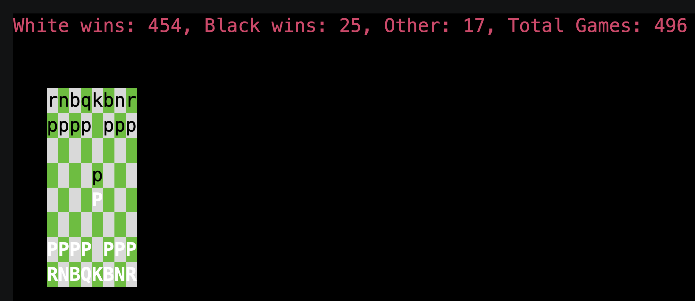

---
author:
  - Mike Renfro, PhD\thanks{Director and Compulsive Advice-Giver}
  - Sharon Colson\thanks{Senior Research Technology Engineer}
  - Jim Moroney\thanks{Research Technology Engineer}
  - Trevor Clark\thanks{Student RCD Facilitator}
shortauthor:
  - Mike Renfro, Sharon Colson, Jim Moroney, Trevor Clark
institute:
  - Research Computing and Data, Information Technology Services, Tennessee Tech University
title: HPC for Advanced High School Students at a Summer Program
subtitle: Governor's School for Emerging Technologies
date: 2026-11-15 (or 16 or 20)
---

# Governor's School for Emerging Technologies

## Overview

### Governor's School for Emerging Technologies (GSET)

::: {.columns align=center}

::: {.column width=50%}

:::

::: {.column width=50%}
- One of 11 Governor's Schools at TN public universities for rising 11th and 12th grade students nominated by their school faculty/staff
- Usually 35--40 GSET students
- 3 week duration, time spent on:
  - mornings: "Introduction to Emerging Technologies" with activities including physical engineering design, human-centered software design, data science, and cybersecurity (all students, 1 credit hour).
  - afternoons: learning about a research area (usually groups of 6--7 students)
:::

:::

## "Introduction to HPC" Research Area

### "Introduction to HPC" Research Area

::: {.columns align=center}

::: {.column width=50%}

:::

::: {.column width=50%}

- Pre-2023, the HPC group was led by a CS faculty member and more focused on parallel programming on Raspberry Pis.
- Our version of HPC has been a research group since 2023, and goes a mile wide and an inch deep on applications and implementations of HPC.
- Our students decide on a final project that needs lots of computation.
- On last day of program, each group presents their research area and project to the other groups and faculty/staff.

:::
:::

## What We Spend Time On

### What We Spend Time On

It's never been the same across years, but major topics and activities have included:

::: {.columns align=top}

::: {.column width=50%}

- Concepts of parallel and distributed computing:
  - The power wall and why we need multi-core architectures
  - Amdahl's law, speedup factors, scaling
  - Unplugged exercise: sorting craft beads by color with 1 or more students
- Intro to the Unix Shell (Software Carpentry)
:::
::: {.column width=50%}
- Building a basic HPC with OpenHPC:
  - virtually on their own laptops,
  - physically with cast-off desktops
- Just enough networking to understand DHCP/PXE for booting their compute nodes
- Basic analysis of algorithms and speedup factors
- Concepts of OpenMP and MPI
- Concepts of machine learning and neural networks
:::
:::

**New for 2026: careers in research computing, CaRCC-style facings**

## Final Projects/Presentations/Live Demos

- 2023: Stockfish chess engine using MPI on student-built cluster
- 2024: machine learning for Lunar Lander
- 2025: machine learning for Tetris
- 2026: image recognition (MNIST, Let's Draw)

# What We Covered, and How

## Subtopic 2.1

### Slide 2.1.1

x

## Subtopic 1.2

### Slide 2.2.1

x

## Subtopic 2.3

### Slide 2.3.1

x

## Subtopic 2.4

### Slide 2.4.1

x

# What We Learned From Projects

## 2023: Stockfish chess engine

::: {.columns align=top}

::: {.column width=50%}

- Two Stockfish MPI engines playing within a very short time limit.
- Stockfish win/loss ratio scales with resources given (could be biased by at least 20:1 on their cluster).
- Mike wrote a quick and dirty text visualization of chess games inabout 130 lines of Python using [`chess`](https://pypi.org/project/chess/) and [`asciimatics`](https://pypi.org/project/asciimatics/). Python script also ran MPI Stockfish via `srun` jobs.

:::
::: {.column width=50%}

:::
:::

## 2024: Machine learning for Lunar Lander

- Using [`gymnasium`](https://gymnasium.farama.org) for game engine
- Solution spaces is small
  - Observations: 2 positions, 2 velocities, angle, angular velocity, whether each leg has touched down
  - Actions: wait, fire left engine, fire main engine, fire right engine
- Actor-critic and deep Q-learning algorithms
- Performance comparison of ML training on their cluster vs the Tech cluster
- Interactive version of Lunar Lander showed how difficult it is for a human to control:
  - purely binary on/off control of engines, has to be toggled extremely quickly to maintain control
  - bug in gymnasium code made lander more difficult for humans to control: side thrusters change positions depending on lander angle
- Even a naive reinforcement learning algorithm can adapt around both of those

## 2025: Machine learning for Tetris

- This one was much harder than we expected
- Enormously larger solution space than Lunar Lander

## 2026: Image recognition (MNIST, Let's Draw)

- This one was also harder than we expected

# Wrapping Up

x