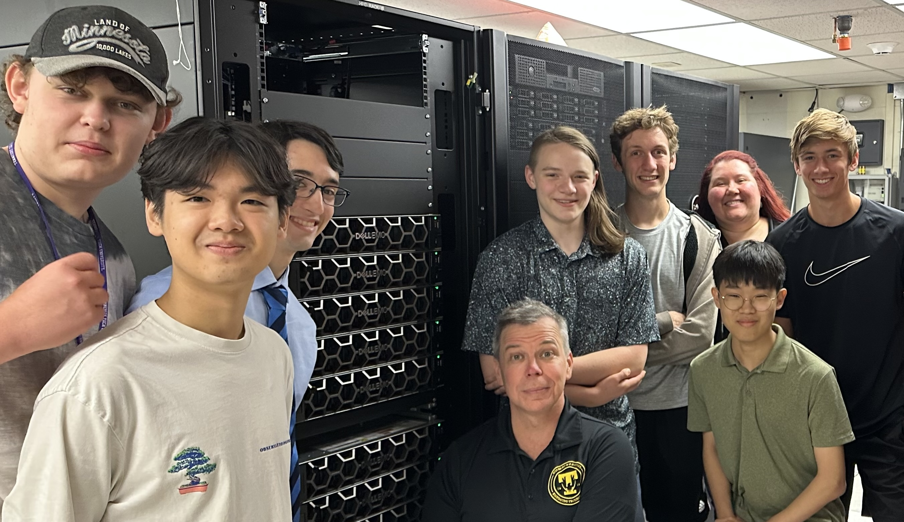
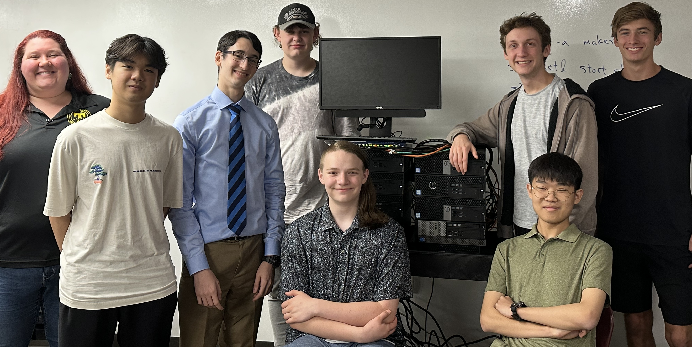

---
author:
  - Mike Renfro, PhD\thanks{Director and Compulsive Advice-Giver}
  - Sharon Colson\thanks{Senior Research Technology Engineer}
  - Jim Moroney\thanks{Research Technology Engineer}
  - Trevor Clark\thanks{Student RCD Facilitator}
shortauthor:
  - Mike Renfro, Sharon Colson, Jim Moroney, Trevor Clark
institute:
  - Research Computing and Data, Information Technology Services, Tennessee Tech University
title: Teaching HPC to Advanced High School Students at a Summer Program
shorttitle: Teaching HPC at an Advanced High School Student Program
subtitle: Governor's School for Emerging Technologies
date: HPCSYSPROS26, 2026-11-16
---

# Governor's School for Emerging Technologies

## Overview

### Governor's School for Emerging Technologies (GSET)

::: {.columns align=center}

::: {.column width=50%}

:::

::: {.column width=50%}
- One of 11 Governor's Schools at TN public universities for rising 11th and 12th grade students nominated by their school faculty/staff
- Usually 35--40 GSET students
- 3 week duration, time spent on:
  - mornings: "Introduction to Emerging Technologies" with activities including physical engineering design, human-centered software design, data science, and cybersecurity (all students, 1 credit hour).
  - afternoons: learning about a research area (usually groups of 6--7 students)
:::

:::

## "Introduction to HPC" Research Area

### "Introduction to HPC" Research Area

::: {.columns align=center}

::: {.column width=50%}

:::

::: {.column width=50%}

- Pre-2023, the HPC group was led by a CS faculty member and more focused on parallel programming on Raspberry Pis.
- Our version of HPC has been a research group since 2023, and goes a mile wide and an inch deep on applications and implementations of HPC.
- Our students decide on a final project that needs lots of computation.
- On last day of program, each group presents their research area and project to the other groups and faculty/staff.

:::
:::

## What We Spend Time On

### What We Spend Time On

It's never been the same across years, but major topics and activities have included:

::: {.columns align=top}

::: {.column width=50%}

- Concepts of parallel and distributed computing:
  - The power wall and why we need multi-core architectures
  - Amdahl's law, speedup factors, scaling
  - Unplugged exercise: sorting craft beads by color with 1 or more students
- Intro to the Unix Shell (Software Carpentry)
:::
::: {.column width=50%}
- Building a basic HPC with OpenHPC:
  - virtually on their own laptops,
  - physically with cast-off desktops
- Just enough networking to understand DHCP/PXE for booting their compute nodes
- Basic analysis of algorithms and speedup factors
- Concepts of OpenMP and MPI
- Concepts of machine learning and neural networks
:::
:::


**New for 2026: careers in research computing, CaRCC-style facings**

## Final Projects/Presentations/Live Demos

- 2023: Stockfish chess engine using MPI on student-built cluster
- 2024: machine learning for Lunar Lander
- 2025: machine learning for Tetris
- 2026: image recognition (MNIST, Google's "Quick, Draw!")

# What We Covered, and How

## Concepts of HPC

### The basics

- What HPC is, where it gets used
- Moore's Law
- The power wall, and relative power efficiency of multi-core architectures
- Amdahl's Law
- Top 500, and how it's changed over time

### Serial and parallel bead sorting by color

::: {.columns align=top}

::: {.column width=50%}

- Reference: [Integrating Parallel and Distributed Computing in Introductory Programming Classes](https://www.csc.tntech.edu/pdcincs/)
- Separate a set of 500 colored beads by color, using 1, 2, 4, ... people
- It's tedious for 1 person, so there's motivation and competitiveness to speed things up
- That leads into concepts of optimization and algorithms in the broadest sense
- Sorting times lead directly into speedup graphs

:::
::: {.column width=50%}

![2-processor bead sorting exercise]

[2-processor bead sorting exercise]: figures/bead-sorting.jpg { width=70% }

:::
:::

## Unix Command Line, Build an HPC

### Software Carpentry's "Introduction to the Unix Command Line"

- Already built for novices who just want to get something done
- Can be run on student laptops, or on the campus HPC
- Doesn't come close to preparing students for systems administration, but we can at least refer back to these topics as needed

### Build-An-HPC Workshop

::: {.columns align=top}

::: {.column width=50%}

- Desktop hypervisor download and installation
- Virtual network configuration
- Installing a VM for an OpenHPC system management server (SMS)
- Just enough networking to explain DHCP
- Installing OpenHPC, building and booting a compute node VM
- Fixing what wasn't working out of the box (better in 2026 than 2023)
- Repeating it all on physical hardware

:::
::: {.column width=50%}

![Non-threatening title slide]

[Non-threatening title slide]: figures/mike-and-sharon-and-jim-and-trevor-build-an-hpc-workshop.png { width=100% }

:::
:::

## Basics of Parallel Programming

### Basics of Parallel Programming

- Modern Fortran, OpenMP, MPI
- Monte Carlo method for calculating $\pi$
- Minimum structured programming concepts required for serial version:
  - top to bottom order
  - loops
  - conditionals
  - calling functions
  - data types

### Serial version (16 LoC)

```fortran
program monte_carlo_serial_pi
  implicit none
  real :: x, y, r
  integer*8 :: i, close_enough = 0_8, total = 1e12_8
  print *, "# total =", total
  do i=1, total
    call random_number(x)
    call random_number(y)
    r = sqrt(x*x + y*y)
    if (r<=1.0) then
      close_enough = close_enough + 1
    end if
  end do
  print *, "# close_enough =", close_enough, "total =", total
  print *, "# Pi is approximately", 4.0*close_enough/total
end program monte_carlo_serial_pi
```

### New concepts introduced in OpenMP version

- elapsed time measurement (serial code just used `time` utility)
- `!$omp parallel` statements
- automatic division of work across CPUs
- private and shared variables
- reductions

### OpenMP version (26 LoC, part 1 of 2)

```fortran
program monte_carlo_openmp_pi
  use omp_lib
  implicit none
  real :: x, y, r
  integer*8 :: i, close_enough = 0_8, total = 1e9_8
  integer :: nodes = 1, cpus_per_node
  double precision :: time_start, time_end
  print *, "# total =", total
  time_start = omp_get_wtime()
!$omp parallel do private(i, x, y, r) reduction(+:close_enough)
  do i=1, total
    call random_number(x)
    call random_number(y)
    r = sqrt(x*x + y*y)
```

### OpenMP version (26 LoC, part 2 of 2)

```fortran
    if (r<=1.0) then
      close_enough = close_enough + 1
    end if
  end do
  time_end = omp_get_wtime()
  print *, "# close_enough =", close_enough, "total =", total
  print *, "# Pi is approximately", 4.0*close_enough/total
!$omp parallel
  cpus_per_node = omp_get_num_threads()
!$omp end parallel
  print *, nodes, cpus_per_node, time_end-time_start
end program monte_carlo_openmp_pi
```

### New concepts introduced in hybrid MPI/OpenMP version

- MPI initialization
- manual division of work across nodes
- MPI reductions

### Hybrid MPI/OpenMP version (46 LoC, part 1 of 4)

```fortran
program monte_carlo_openmp_mpi_pi
  use omp_lib
  use mpi
  implicit none
  real :: x, y, r
  integer*8 :: i, close_enough = 0_8, total = 1e9_8
  integer :: nodes, cpus_per_node, rank, ierr
  integer*8 :: base_size, bigger_count, my_size, total_close_enough
  double precision :: time_start, time_end

  call mpi_init(ierr)
  call mpi_comm_size(MPI_COMM_WORLD, nodes, ierr)
  call mpi_comm_rank(MPI_COMM_WORLD, rank, ierr)
```

### Hybrid MPI/OpenMP version (46 LoC, part 2 of 4)

```fortran
  base_size = total / nodes
  bigger_count = modulo(total, nodes)
  print *, "# total =", total, "base_size =", base_size, &
    "bigger_count =", bigger_count
  if (rank < bigger_count) then
    my_size = base_size+1
    print *, "# rank", rank, &
      "gets an extra iteration: my_size =", my_size
  else
    my_size = base_size
    print *, "# rank", rank, &
    "gets no extra iterations: my_size =", my_size
  end if
```

### Hybrid MPI/OpenMP version (46 LoC, part 3 of 4)

```fortran
  time_start = omp_get_wtime()
!$omp parallel do private(i, x, y, r) reduction(+:close_enough)
  do i=1, my_size
    call random_number(x)
    call random_number(y)
    r = sqrt(x*x + y*y)
    if (r<=1.0) then
      close_enough = close_enough + 1
    end if
  end do

  print *, "# rank =", rank, "close_enough =", close_enough, &
    "my_size =", my_size

```

### Hybrid MPI/OpenMP version (46 LoC, part 4 of 4)

```fortran
  call mpi_reduce(close_enough, total_close_enough, 1, &
    mpi_integer8, mpi_sum, 0, MPI_COMM_WORLD, ierr)
  call mpi_finalize(ierr)
  time_end = omp_get_wtime()

  if (rank == 0) then
    print *, "# total_close_enough =", total_close_enough, &
      "total =", total
    print *, "# Pi is approximately", 4.0*total_close_enough/total
!$omp parallel
    cpus_per_node = omp_get_num_threads()
!$omp end parallel
    print *, nodes, cpus_per_node, time_end-time_start
  end if
end program monte_carlo_openmp_mpi_pi
```

## Careers in Research Computing

### Careers in Research Computing

- In 2025, we finally got our dedicated Research Computing and Data division in ITS
- We call ourselves RCD instead of HPC for a reason
- We also realized that the GSET students, their teachers, their guidance counselors, and their families would likely have no idea how broad our field is
- Mike, Sharon, Jim, and Trevor also:
  - come from widely different academic backgrounds and life experiences
  - have widely different skill sets and vocational passions
- All of this got us to spend an afternoon talking about how:
  - we all fit into a cohesive RCD group
  - we don't have to be experts in everything
  - **our users are better** at their respective specialties
  - **we're better** at adapting technology to their needs

### And it stuck with them

![Student presentation section about RCD careers]

[Student presentation section about RCD careers]: figures/gset-facings.jpg { width=80% }

### CaRCC's *Onramps to the RCD Field*

::: {.columns align=top}

::: {.column width=70%}

- Sharon, Jim, and several dozen other people attended a full-day track of CaRCC's RCD Nexus Day at PEARC26.
- The result of that day was CaRCC's *Onramps to the RCD Field: A Guide to Careers in Research Computing and Data*
- Intended audience is primarily people outside reseach computing:
  - students (high school or college)
  - guidance counsleors, career counselors
  - folks considering a career change
  - faculty and administrators building career pipelines

:::

::: {.column width=30%}


:::
:::

# What We Learned From Projects

## 2023: Stockfish chess engine

::: {.columns align=top}

::: {.column width=50%}

- Two Stockfish MPI engines playing within a very short time limit.
- Stockfish win/loss ratio scales with resources given (could be biased by at least 20:1 on their cluster).
- Mike wrote a quick and dirty text visualization of chess games in about 130 lines of Python using [`chess`](https://pypi.org/project/chess/) and [`asciimatics`](https://pypi.org/project/asciimatics/). Python script also ran MPI Stockfish via `srun` jobs.

:::
::: {.column width=50%}


:::
:::

## 2024: Machine learning for Lunar Lander

- Using [`gymnasium`](https://gymnasium.farama.org) for game engine
- Solution space is small
  - Observations: 2 coordinates, 2 velocities, lander angle, lander angular velocity, whether each leg has touched down
  - Actions: wait, fire left engine, fire main engine, fire right engine
- Actor-critic and deep Q-learning algorithms
- Performance comparison of ML training on their cluster vs the Tech cluster
- Interactive version of Lunar Lander showed how difficult it is for a human to control:
  - purely binary on/off control of engines, has to be toggled extremely quickly to maintain control
  - bug in `gymnasium` code: side thrusters change positions depending on lander angle
- Even a naive reinforcement learning algorithm can adapt around both of those

## 2025: Machine learning for Tetris

- This one was much harder than we expected
- Enormously larger solution space than Lunar Lander
- We got out of our own depth on guessing what kind of neural network could be trained in a feasible amount of time

## 2026: Image recognition (MNIST, Google "Quick, Draw!")

- This one was also harder than we expected
- Didn't have time to make a good visualization or interactive demo: would have loved to show their neural network classifying other students' drawings in real time
- Wound up being able to show improved classification performance during training, but not much more

# Wrapping Up

::: {.columns align=center}

::: {.column width=70%}
- HPC and RCD topics are within high school students' reach
- Be ready for things to go wrong
- Let the students see you fail sometimes
- Contact us if you have questions:
  - `{renfro,scolson,jmoroney,sw-tlclark}@tntech.edu`
  - `researchcomputing@tntech.edu`
  - [`www.rcd.tntech.edu`](https://www.rcd.tntech.edu/)
:::

::: {.column width=30%}

:::
:::

